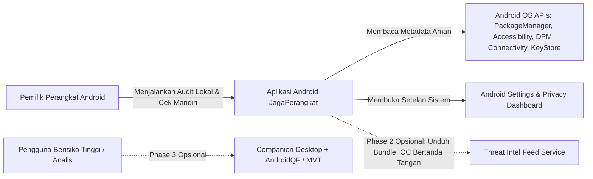
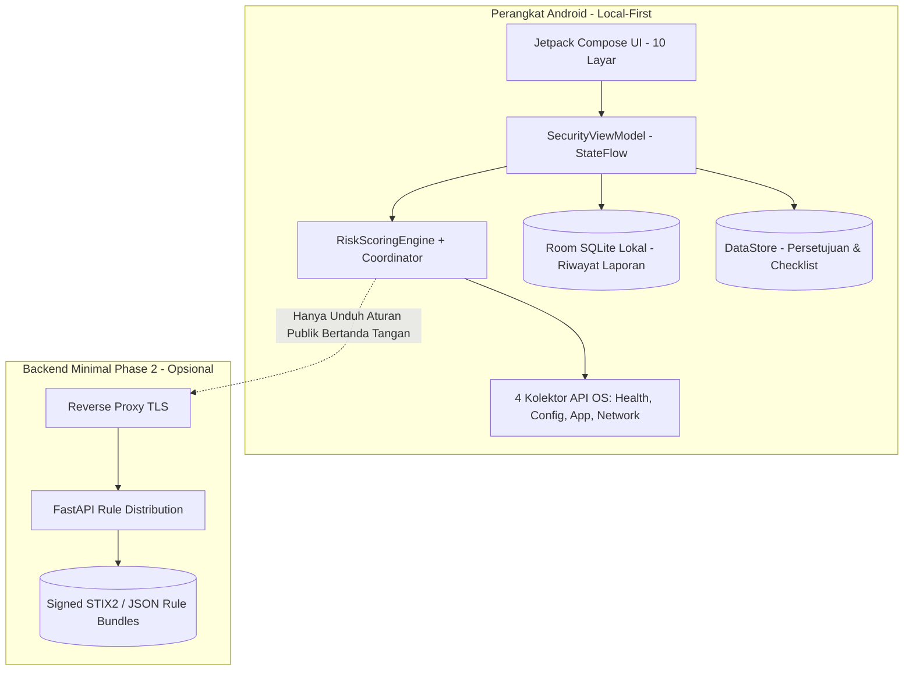
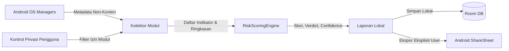
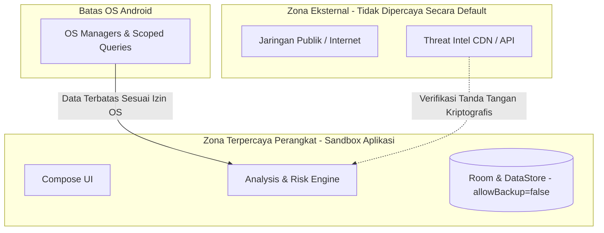
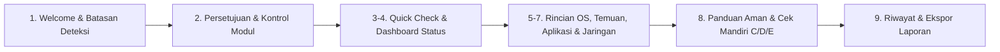
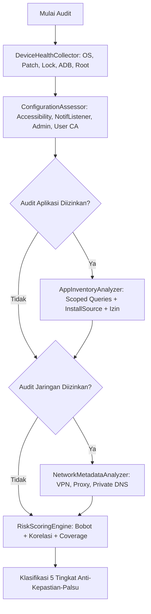
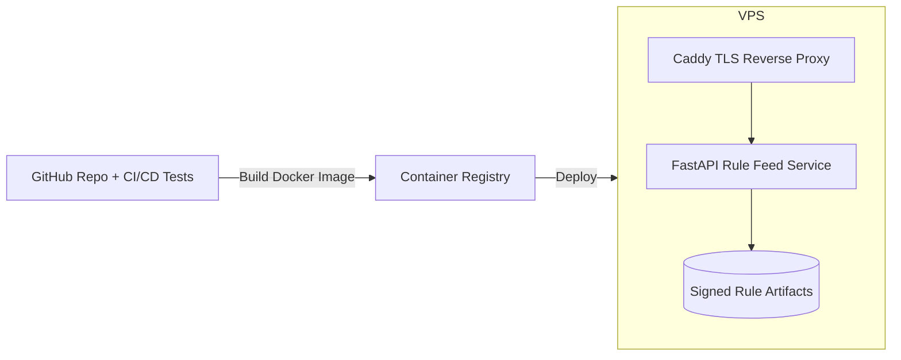

# JAGAPERANGKAT — GATE 1 & GATE 2: RISET MENDALAM, FEASIBILITY, PRD, DAN ARSITEKTUR FULL-STACK

**Status Dokumen:** DESIGNED & PARTIALLY IMPLEMENTED (MVP Android App di `/app/`)  
**Tanggal Penyusunan:** 19 November 2026  
**Bahasa:** Bahasa Indonesia  

---

## GATE 1 — EVIDENCE, THREAT ANALYSIS & ANDROID API FEASIBILITY

### 1.1 Pemisahan Batas Fundamental Kemampuan Deteksi (Kategori A–E)

| Kategori | Ruang Lingkup Ancaman | Kemampuan Aplikasi Android Konsumen (Tanpa Root) |
|---|---|---|
| **A** | Spyware / Stalkerware dengan indikator lokal | **TERDETEKSI PARSIAL (Direct OS API + Heuristik):** AccessibilityService aktif, NotificationListener aktif, Device Admin aktif, sumber instalasi sideload, izin sensitif (jika paket terlihat). |
| **B** | Aktivitas/konfigurasi & metadata jaringan mencurigakan | **TERDETEKSI LANGSUNG (Metadata):** Kunci layar mati, ADB aktif, patch tertinggal, User CA Certificate terpasang, HTTP Proxy/VPN aktif. Tidak membuktikan penyadapan secara tunggal. |
| **C** | Penyalahgunaan akun digital, perangkat tertaut, pengalihan panggilan | **PANDUAN PENGGUNA (Guided Check):** Perangkat tertaut WhatsApp/Telegram, Google Security Checkup, cek MMI `*#21#` / `*#62#`. Tidak bisa diaudit otomatis oleh aplikasi lain karena sandbox akun. |
| **D** | Intersepsi jaringan seluler, SIM swap, IMSI catcher, SS7/Diameter | **TIDAK DAPAT DIDETEKSI APLIKASI:** Hanya dapat ditanggapi lewat edukasi pengguna (nonaktifkan 2G di Android 12+, hubungi operator jika sinyal hilang mendadak). |
| **E** | Serangan OS, kernel, firmware, baseband, eksploit zero-click (mis. Pegasus) | **BUTUH FORENSIK EKSTERNAL:** Tidak terlihat dari API aplikasi Android biasa. Memerlukan akuisisi & analisis forensik komputer (AndroidQF + Amnesty MVT) dan/atau Android Advanced Protection Mode. |

---

### 1.2 Kajian Ancaman Utama (14 Vektor)

1. **Commercial Spyware & Stalkerware (FAKTA TERVERIFIKASI):** Menggunakan penyalahgunaan Accessibility Service (MITRE ATT&CK Mobile T1403), Notification Listener (T1517), penghilangan ikon launcher (T1426), dan eksfiltrasi C2 (T1041). Keterbatasan: aplikasi tanpa ikon peluncur tidak muncul di kueri `CATEGORY_LAUNCHER` tanpa `QUERY_ALL_PACKAGES`.
2. **Aplikasi Sideload & Berbahaya:** Teramati via `PackageManager.getInstallSourceInfo()` (API 30+) atau `FLAG_DEBUGGABLE`. Aplikasi dari luar Play Store/toko OEM bukan berarti otomatis malware (mis. F-Droid), sehingga wajib dikorelasikan dengan hak istimewa lain.
3. **Penyalahgunaan Accessibility Service:** Dapat membaca konten layar dan mencegat ketukan. Terdeteksi akurat via `AccessibilityManager.getEnabledAccessibilityServiceList()`, namun Google Play melarang aplikasi pihak ketiga bertindak sebagai pembunuh paksa layanan lain; tindakan mitigasi harus dilakukan oleh pengguna melalui Setelan Android.
4. **Penyalahgunaan Izin Kamera, Mikrofon, Lokasi, Notifikasi:** Aplikasi pihak ketiga tidak memiliki log riwayat kapan aplikasi *lain* menyalakan mikrofon/kamera. Alternatif sah: memeriksa izin yang disetujui via `PackageManager.checkPermission()` dan mengarahkan pengguna ke **Android Privacy Dashboard** (`ACTION_REVIEW_PERMISSION_USAGE`).
5. **Device Administrator Tidak Sah:** Terdeteksi langsung via `DevicePolicyManager.activeAdmins`. Normal untuk perangkat kerja (MDM/Profile Owner).
6. **Perilaku Jaringan Mencurigakan:** Tanpa `VpnService` lokal, aplikasi hanya membaca status jaringan aktif (`ConnectivityManager`). Dengan `VpnService` (Fase 2), hanya header tujuan IP/DNS (SNI/DNS query) yang terlihat — isi payload HTTPS tetap terenkripsi.
7. **VPN, Proxy, & Sertifikat CA Pengguna:** `LinkProperties.httpProxy`, `NetworkCapabilities.TRANSPORT_VPN`, `LinkProperties.isPrivateDnsActive`, dan `KeyStore.getInstance("AndroidCAStore")` (prefix `user:`) dapat diperiksa langsung dan andal tanpa root.
8. **Perubahan Konfigurasi Keamanan Perangkat:** `KeyguardManager.isDeviceSecure`, `Settings.Global.ADB_ENABLED`, `Build.VERSION.SECURITY_PATCH`, dan `AdvancedProtectionManager` (Android 16/API 36) memberikan sinyal keras tanpa izin sensitif.
9. **Kompromi Akun Google/Komunikasi & Linked Devices:** Terisolasi di luar sandbox Android app; ditangani lewat panduan interaktif (Kategori C).
10. **Pengalihan Panggilan & SIM Swap:** Hanya dapat dicek pengguna melalui pengaturan telepon/MMI atau operator seluler.
11. **Intersepsi Seluler/Radio (Stingray/SS7):** Di luar jangkauan API publik Android konsumen.
12. **Root Compromise & Modifikasi Sistem:** Indikator read-only (`Build.TAGS` `test-keys`, keberadaan biner `su` di path standar) hanya bersifat heuristik awal dan bisa disembunyikan oleh rootkit/Magisk DenyList.
13. **Exploit Tingkat Tinggi (Zero-Click):** Memerlukan analisis artefak sistem lewat ADB/backup oleh komputer tepercaya menggunakan **AndroidQF** dan **MVT**.

---

### 1.3 Android API Feasibility Matrix

| Fitur | API atau Metode | Min Android | Permission | Tanpa Root? | Otomatis? | Batasan Google Play | Keandalan | Keputusan |
|---|---|---|---|---|---|---|---|---|
| F01 Health Check | `Build.VERSION`, `KeyguardManager`, `Settings.Global` | API 23/24 | Tidak ada | Ya | Ya | Patuh penuh | Tinggi (API langsung) | **GO (MVP)** |
| F01 Advanced Protection | `AdvancedProtectionManager` | API 36 (Android 16) | `QUERY_ADVANCED_PROTECTION_MODE` (opsional) | Ya | Ya | Patuh penuh | Tinggi (hanya Android 16+) | **CONDITIONAL GO (MVP fallback aman)** |
| F02 App Inventory (Terlingkup) | `PackageManager` + `<queries>` | API 24 (InstallSource API 30+) | Tidak perlu `QUERY_ALL_PACKAGES` | Ya | Ya | Sangat patuh | Sedang (hanya paket terlihat) | **GO (MVP)** |
| F02 App Inventory (Menyeluruh) | `PackageManager.getInstalledPackages` + `QUERY_ALL_PACKAGES` | API 30+ | `QUERY_ALL_PACKAGES` | Ya | Ya | **Ketat:** Wajib Permissions Declaration Form & bukti fungsi inti keamanan | Tinggi untuk APK terpasang | **CONDITIONAL GO (Pasca-verifikasi Play Console)** |
| F03 Riwayat Akses Sensor | Android Privacy Dashboard Intent (`REVIEW_PERMISSION_USAGE`) | API 31+ | Tidak ada | Ya | Tidak (buka UI OS) | Patuh penuh | Tinggi (data resmi OS) | **GO (MVP)** |
| F03 Daftar Izin Aplikasi | `PackageManager.checkPermission` | API 24 | Terlingkup `<queries>` | Ya | Ya | Patuh penuh | Tinggi | **GO (MVP)** |
| F04 Metadata Jaringan Dasar | `ConnectivityManager`, `LinkProperties`, `AndroidCAStore` | API 24 (Private DNS API 28+) | `ACCESS_NETWORK_STATE` (Normal) | Ya | Ya | Patuh penuh | Tinggi | **GO (MVP)** |
| F04 Inspeksi DNS/IP via VPN Lokal | `android.net.VpnService` | API 24 | `BIND_VPN_SERVICE` + persetujuan sistem | Ya | Perlu aktifkan VPN | **Ketat:** Wajib deklarasi Play Console, bentrok dengan VPN lain pengguna | Sedang (hanya metadata header) | **CONDITIONAL GO (Phase 2 Opt-in)** |
| F04 Statistik Kuota per Aplikasi | `NetworkStatsManager` / `UsageStatsManager` | API 23 | `PACKAGE_USAGE_STATS` (izin khusus) | Ya | Perlu aktivasi manual di Setelan | Perlu pengungkapan jelas | Sedang | **CONDITIONAL GO (Phase 2)** |
| F05 Config Risk Review | `AccessibilityManager`, `DevicePolicyManager`, `Settings.Secure` | API 24 | Tidak ada | Ya | Ya | Patuh penuh | Tinggi | **GO (MVP)** |
| Forensik OS / Baseband / Log Kernel | `adb`, `bugreport`, AndroidQF, MVT | Desktop + USB Debugging | Otorisasi ADB eksplisit | Ya (via PC) | Tidak | Tidak untuk aplikasi Play otomatis | Tinggi untuk artefak sistem | **GO (Phase 3 Companion)** |
| Dekripsi HTTPS / Cek Intersepsi Seluler | Root / Kernel hook / Radio baseband | N/A | Root / Sistem | **Tidak** | Tidak | **Dilarang keras / Tidak mungkin** | N/A | **NO-GO** |

---

### 1.4 Benchmark Solusi yang Tersedia (Min. 5 Solusi Terverifikasi)

| Solusi | Fungsi Utama | Ruang Lingkup Deteksi | Hak Akses / Model | Model Privasi | Harga / Lisensi | Kelemahan Utama |
|---|---|---|---|---|---|---|
| **MVT + AndroidQF** (Amnesty Security Lab) | Ekstraksi & analisis forensik pasca-insiden | Spyware canggih (Pegasus, NoviSpy), IOC STIX2, bugreport/ADB | Desktop + ADB eksplisit pemilik | Open-source, offline penuh di PC analis | Gratis (MPL-2.0 / AGPL) | Tidak ramah pengguna awam; butuh komputer & CLI |
| **Hypatia** (FOSS) | Pemindai malware berbasis signature | Signature file/APK lokal (ClamAV-style) | Akses penyimpanan / app scan lokal | Open-source, tanpa telemetri cloud | Gratis (GPLv3) | Bergantung pembaruan signature; tidak memeriksa konfigurasi akun/CA/jaringan |
| **Malwarebytes Mobile Security** | Antivirus & anti-stalkerware konsumen | Malware, adware, keluarga stalkerware dikenal | `QUERY_ALL_PACKAGES` & izin pemindaian | Telemetri komersial (berkebijakan privasi) | Freemium (berbayar untuk proteksi real-time) | Bersifat komersial/tertutup; heuristik tidak selalu dijelaskan transparan |
| **Certo AntiSpy (Android)** | Audit spyware & privasi konsumen | Aplikasi mencurigakan, izin berisiko, celah konfigurasi | Izin Android standar + app scan | Komersial | Freemium / Langganan | Fokus komersial; tidak mencakup forensik level MVT |
| **Google Play Protect & Privacy Dashboard** | Proteksi bawaan ekosistem Android | Verifikasi aplikasi Play/sideload & log akses sensor 24 jam | Hak istimewa sistem (OS-level) | Terintegrasi akun Google/Play | Bawaan gratis (Android resmi) | Tidak melakukan korelasi risiko konfigurasi + jaringan + panduan stalkerware lokal |

---

### 1.5 Ringkasan Keputusan Gate 1 (Handoff Summary)

- **Keputusan Utama:** Fitur **F01, F02 (terlingkup), F03 (izin + Privacy Dashboard), F04 (metadata koneksi + CA), F05, F06, F07, dan F08** berstatus **GO** untuk MVP tanpa root dan tanpa izin `QUERY_ALL_PACKAGES`. Fitur `VpnService` dan `UsageStatsManager` ditunda ke **Phase 2 (Conditional Go)**; integrasi **MVT/AndroidQF** masuk **Phase 3**; klaim deteksi intersepsi seluler atau dekripsi lalu lintas berstatus **NO-GO**.
- **Fakta Terverifikasi:** Android 11+ membatasi visibilitas paket; `AccessibilityManager`, `DevicePolicyManager`, `AndroidCAStore`, dan `ConnectivityManager` dapat diakses legal tanpa izin berbahaya.
- **Informasi Belum Terkalibrasi:** Bobot numerik awal skor risiko masih berupa asumsi ahli (*expert judgment*) dan memerlukan kalibrasi dataset uji terkendali sebelum rilis publik skala luas.
- **Handoff untuk Tahap Berikutnya:** Bangun arsitektur **local-first** di Kotlin/Compose dengan Room + DataStore, 4 modul kolektor independen, dan panduan interaktif Kategori C/D/E.

---

## GATE 2 — PRODUCT REQUIREMENTS DOCUMENT (PRD) & ARSITEKTUR FULL-STACK

### 2.1 Prioritas Fitur PRD (Hanya Fitur Lolos Gate 1)

- **MVP (Phase 1 — Telah Diimplementasikan di Kode Aplikasi):**
  - **F01** Device Security Health Check (OS, patch, kunci layar, ADB, root indicators, Android 16 Advanced Protection).
  - **F02** Suspicious Application Assessment (terlingkup via `<queries>`, sumber instalasi, flag `debuggable`/`testOnly`).
  - **F03** Sensitive Permission Review (izin kamera/mikrofon/lokasi/SMS/overlay + tautan ke Android Privacy Dashboard).
  - **F04** Network Anomaly Assessment (VPN aktif, HTTP Proxy, Private DNS, User CA Certificates).
  - **F05** Device Configuration Risk Review (Accessibility Service aktif, Notification Listener aktif, Device Admin aktif).
  - **F06** Surveillance Risk Scoring (formula transparan + 5 kategori keluaran anti-kepastian-palsu).
  - **F07** User Security Guidance (rekomendasi kontekstual + Protokol Keselamatan Korban Stalkerware + Checklist Kategori C/D/E).
  - **F08** Security Assessment Report (riwayat Room lokal + perbandingan delta + ekspor teks lokal).
- **Phase 2 (Lanjutan — Pasca-MVP):** Pembaruan daftar indikator IOC bertanda tangan digital (Ed25519/ECDSA) via backend minimal, reputasi domain opsional (opt-in eksplisit), dan DNS monitoring opt-in via `VpnService`.
- **Phase 3 (Forensik Opsional):** Companion desktop yang mengimpor/memvisualisasikan bundel JSON dari **AndroidQF / MVT** untuk jurnalis & organisasi sipil.

### 2.2 Arsitektur Aplikasi Android (Clean MVVM, Local-First)

- **UI Layer (`ui/screens`, `ui/components`, `ui/theme`):** Jetpack Compose + Material 3, edge-to-edge (`WindowInsets.safeDrawing`), font lokal `Plus Jakarta Sans` & `JetBrains Mono`, adaptif `NavigationBar` (<600dp) / `NavigationRail` (>=600dp).
- **Presentation Layer (`ui/viewmodel`):** `SecurityViewModel` dengan `StateFlow` dan `collectAsStateWithLifecycle`.
- **Domain Layer (`domain/model`, `domain/engine`):** `RiskScoringEngine` murni Kotlin tanpa ketergantungan framework UI, mudah diuji lewat unit test JVM.
- **Data & Scanner Layer (`data/scanner`, `data/local`):** `DeviceHealthCollector`, `ConfigurationAssessor`, `AppInventoryAnalyzer`, `NetworkMetadataAnalyzer`, `SecurityAssessmentCoordinator`, `AppDatabase` (Room + KSP), dan `PrivacyPreferencesRepository` (DataStore).

### 2.3 Arsitektur Backend Minimal (Phase 2 — Tidak Diperlukan untuk Menjalankan MVP)

- **Prinsip:** MVP berjalan **100% offline/on-device** sehingga **biaya server MVP = $0** dan risiko kebocoran data pribadi di cloud = **nol**.
- **Rancangan Backend Phase 2 (Efisien & Serverless/Container):**
  - **FastAPI (Python 3.12)** di balik reverse proxy **Caddy/Nginx (TLS 1.3)** untuk distribusi **Signed Threat Intelligence Rule Bundles** (IOC package/domain dari sumber publik seperti Coalition Against Stalkerware / Amnesty STIX2).
  - **PostgreSQL + Redis:** Hanya dibutuhkan jika fitur lookup reputasi domain opt-in (Phase 2) diaktifkan; **bukan** untuk menyimpan profil perangkat atau riwayat scan pengguna.

### 2.4 Diagram Arsitektur Wajib (Mermaid)

#### 1. System Context Diagram

#### 2. Full-Stack Architecture Diagram

#### 3. Data Flow Diagram (DFD)

#### 4. Trust Boundary Diagram

#### 5. User Journey

#### 6. Detection Workflow

#### 7. Deployment Architecture (Phase 2 Backend Opsional)

### 2.5 Ringkasan Keputusan Gate 2 (Handoff Summary)

- **Keputusan:** Arsitektur **local-first** tanpa server wajib di MVP memaksimalkan privasi pengguna sekaligus menghilangkan biaya backend di fase awal. Seluruh 10 layar UX telah dipetakan ke 5 rute utama + layar onboarding persetujuan.
- **Handoff ke Gate 3:** Verifikasi formula matematis skor risiko, pemodelan ancaman STRIDE, dan kepatuhan UU PDP No. 27 Tahun 2022.
